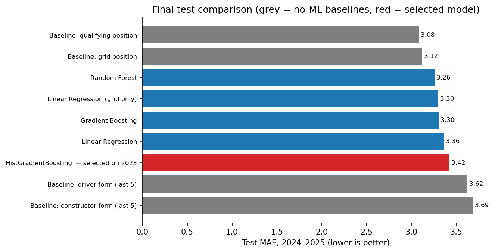
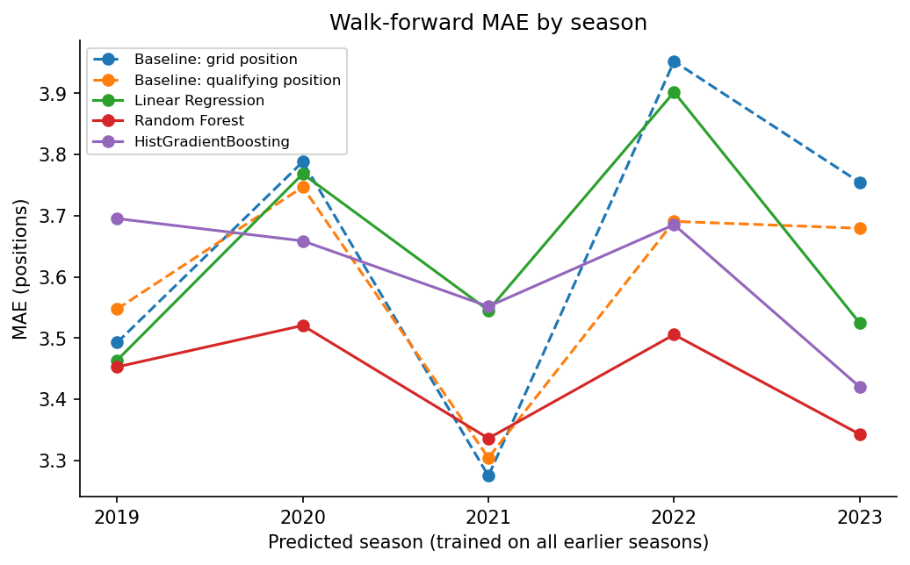
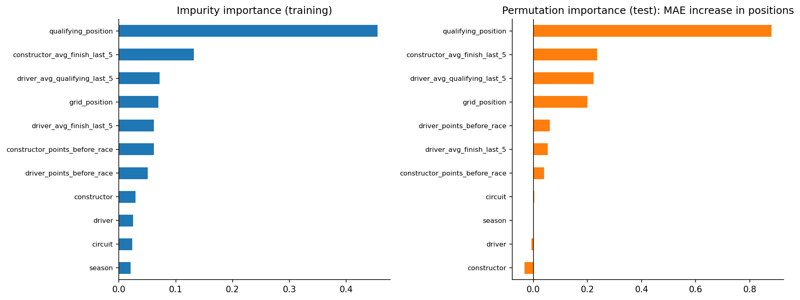
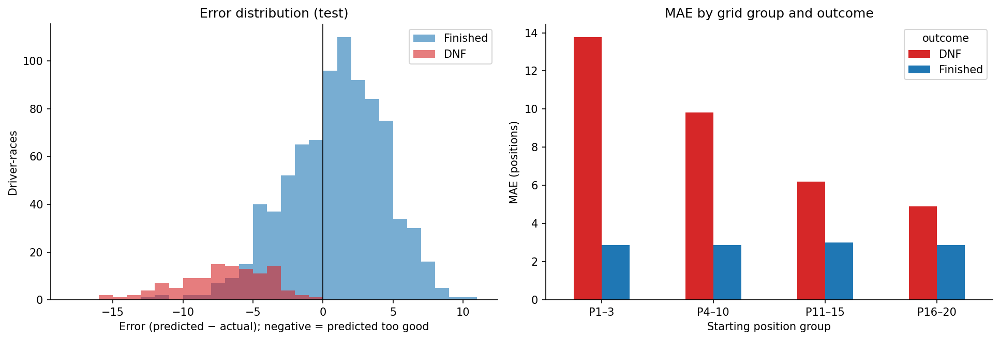

# F1 Race Finishing Position Prediction

**How accurately can Formula 1 finishing positions be predicted using only information available before the race, and what information actually matters?**

This project uses race and qualifying results from 2018–2025 (3,458 driver-race rows, 173 races) to predict each driver's finishing position from pre-race information. It compares machine-learning models against simple F1 heuristics, using a strict temporal split: train on 2018–2022, select on 2023, test once on 2024–2025.

**Main finding:** starting position captures most of the available pre-race signal. On the held-out 2024–2025 seasons, "finish = qualifying position" (MAE 3.08) and "finish = grid position" (3.12) beat every ML model (best: Random Forest, 3.26). Non-finishes are 11.9% of races but cause 25% of the total error.

The full analysis is in [`notebooks/f1_race_prediction.ipynb`](notebooks/f1_race_prediction.ipynb).

## Dataset

- **Source:** race and qualifying results via the [FastF1](https://docs.fastf1.dev/) Ergast-compatible interface (Jolpica F1 API). No telemetry.
- **Unit of analysis:** one driver in one race.
- **Target:** `final_position`, the official classified position (retired drivers are classified by distance completed).

## Methodology

**Features (all known before the race):** qualifying and grid position; driver, constructor, circuit, season; driver average finish and qualifying position over the last 5 races; constructor average finish over the last 5 races; driver and constructor championship points before the race. A second feature set adds driver finish/qualifying consistency (std over the last 5 races) and driver/constructor non-finish rates over the last 5 races.

**Leakage prevention:** rolling features use `shift(1)` before `rolling(5)`; team features are aggregated per race before rolling; points-before-race = season running total minus that race's points. Three automated checks, all passed:
- a by-hand recalculation of 2,700 feature values (0 mismatches)
- a perturbation test where scrambling a race's results must not change its features (0 of 5 races changed)
- a check that no post-race column is a model input

**Validation:**

| Set | Seasons | Purpose |
|---|---|---|
| Train | 2018–2022 | fit candidates |
| Validation | 2023 | all model, hyperparameter and feature-set decisions |
| Test | 2024–2025 | one final evaluation |

A walk-forward check (train up to season *k − 1*, predict *k*, for 2019–2023) tests stability over time.

**Models:**
- Baselines: grid position, qualifying position, driver recent form, constructor recent form, and a grid-only Linear Regression
- ML models: Linear Regression, Random Forest, Gradient Boosting and HistGradientBoosting, with small grids chosen on 2023
- A two-stage "DNF probability + position" model was tested on 2023 and not adopted

## Results (test seasons 2024–2025, 958 predictions)

| Model | MAE | Median AE | Within ±3 | Within ±5 | Mean error | Race Spearman |
|---|---:|---:|---:|---:|---:|---:|
| Baseline: qualifying position | **3.08** | 2.00 | 68.1% | 82.8% | −0.02 | 0.70 |
| Baseline: grid position | 3.12 | 2.00 | 67.9% | 82.4% | 0.00 | 0.69 |
| Random Forest | 3.26 | 2.75 | 55.5% | 80.2% | 0.00 | 0.67 |
| Linear Regression (grid only) | 3.30 | 2.83 | 52.3% | 81.5% | −0.01 | 0.69 |
| Gradient Boosting | 3.31 | 2.79 | 54.0% | 80.1% | −0.06 | 0.67 |
| Linear Regression | 3.36 | 2.79 | 52.9% | 78.4% | 0.10 | 0.66 |
| HistGradientBoosting (selected on 2023) | 3.41 | 2.94 | 51.2% | 78.5% | −0.07 | 0.65 |
| Baseline: driver form | 3.62 | 3.00 | 51.6% | 75.6% | −0.03 | 0.57 |
| Baseline: constructor form | 3.69 | 3.00 | 51.0% | 73.3% | −0.03 | 0.56 |



**Validation vs test.** On 2023, every ML model beat the grid baseline (3.33–3.53 vs 3.75), and in the walk-forward check the best ML model beat it in 4 of 5 seasons. That advantage did not transfer to 2024–2025. The grid baseline's MAE in 2024 (2.89) was the lowest of all eight seasons, and non-finishes fell from 16.0% to 11.9%. The consistency and reliability features did not improve validation performance for any model family, so they were not used.



## What matters

`qualifying_position` dominates. It accounts for 45.5% of Random Forest impurity importance, and shuffling it raises test MAE by 0.88 places. Constructor recent form (+0.24), driver recent qualifying (+0.22) and grid position (+0.20) follow. Driver, constructor, circuit and season add nothing measurable on the test seasons. Grid and qualifying correlate 0.95, so they share credit. Importance describes what the model uses, not causation.



## Where the model fails

- **Non-finishes:** DNF MAE 7.27 vs 2.89 for finishers. Non-finishes cause 25% of the absolute error and all 10 of the largest errors (e.g. Verstappen, Australia 2024: grid P1, predicted 0.1, classified P19). Even among finishers, the grid baseline is more accurate (2.64 vs 2.89).
- **DNFs are close to unpredictable** from pre-race data: DNF classifier AUC 0.55 on 2023, 0.59 on test.
- **Regression to the mean:** predictions have a spread of 3.75 positions vs 5.76 for actual results. Front-runners who finish are predicted too far back (mean error +1.24 for P1–3 starters), and back-markers too far forward.



## Limitations

Non-finishes and incidents are unpredictable and part of the target. Weather, safety cars, tyre and pit strategy are not in the data. From 2023 the source reports most retirements as "Retired", and late classified retirements as "Lapped". Other limitations:
- regulation changes
- team renames treated as separate teams
- no circuit-specific history
- a single, small validation season (the selected model won by 0.011)
- predictions not clipped to P1–P20

## Future work

- Weather, strategy and reliability data
- Circuit-specific history
- Probabilistic or ranking-based models
- Multi-season validation for model selection

## Inference: predicting a race

The notebook saves the selected model to `models/final_model.joblib`. `predict_race()` in `src/prediction.py` loads that saved model, without retraining, and turns a starting grid into a predicted race order. The last notebook section demonstrates it.

```python
import prediction
table = prediction.predict_race(
    {"season": 2026, "circuit": "Autodromo Nazionale di Monza", "race_name": "Italian Grand Prix"},
    entries,   # DataFrame: driver, constructor, qualifying_position, grid_position
)
```

**Input:** season, circuit, and for each driver their constructor, qualifying position and grid position (grid 0 = pit-lane start).

**Calculated automatically:** each driver's average finish and qualifying position over their last 5 races, their team's average finish over its last 5 races, and driver/team championship points before the race. These come from races **before** the predicted race only, using the same `features.build_features()` code as training. A leakage guard verifies that the race's own (unknown) result cannot affect them.

**Output:** the predicted race order (sorted by the raw model output), plus each driver's expected finishing position, clipped to the valid range for display only.

Example (hypothetical 2026 Italian GP; Leclerc qualifies P5 but starts P10 after a penalty), top 5 of the output:

| Predicted order | Driver | Grid | Expected position |
|---:|---|---:|---:|
| 1 | Lando Norris | 2 | 3.6 |
| 2 | Max Verstappen | 1 | 5.4 |
| 3 | George Russell | 4 | 5.8 |
| 4 | Oscar Piastri | 3 | 6.0 |
| 5 | Fernando Alonso | 5 | 7.3 |

The notebook also checks the pipeline on all 173 historical races: rebuilding each race's features from earlier races only reproduces the research pipeline's features and predictions exactly.

**Limitations:**
- Incidents, retirements, weather, safety cars and strategy are not modelled.
- The saved model is the research model, trained on 2018–2023. Drivers and teams first seen later are treated as unknown categories.
- For a season missing from `data/race_data.csv`, form comes from the last available races and points-before-race is 0.
- On 2024–2025 this model (MAE 3.41) was less accurate than the qualifying-order baseline (3.08).

## How to run

Requires Python 3.12+ (or Anaconda with `pip install fastf1`).

```bash
pip install -r requirements.txt
python src/data_collection.py      # downloads data/race_data.csv (cached; waits automatically if rate-limited)
jupyter notebook notebooks/f1_race_prediction.ipynb   # run all cells once: this also saves models/final_model.joblib
```

## Project structure

```
data/race_data.csv                 results data
notebooks/f1_race_prediction.ipynb full analysis
src/data_collection.py             download + cleaning
src/features.py                    leakage-safe feature engineering (shared by training and inference)
src/prediction.py                  inference: predict_race()
figures/                           saved plots
results/                           test metrics, walk-forward MAE, feature importance (CSV)
models/final_model.joblib          selected model (refit on 2018–2023)
```
